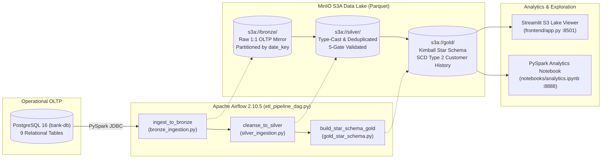

# Enterprise Banking Data Lakehouse — 3-Tier Medallion Batch Architecture

-E25A1C?style=flat-square&logo=apachespark)


-336791?style=flat-square&logo=postgresql)


A containerized, idempotent **Batch Data Lakehouse** implementing the **Medallion Architecture (`Bronze → Silver → Gold`)** on S3-compatible **MinIO** object storage. Orchestrated by **Apache Airflow**, distributed **PySpark** jobs extract 9 operational banking tables from **PostgreSQL (OLTP)** via JDBC, enforce automated **Data Quality Gates** across 5 defect classes, and model a **Kimball Star Schema** with **SCD Type 2** point-in-time historical attribution.

---

## System Architecture



---

## Gold Layer Dimensional Model (Kimball Star Schema)

```mermaid
erDiagram
    FACT_TRANSACTION ||--o{ DIM_ACCOUNT : "account_sk"
    FACT_TRANSACTION ||--o{ DIM_BRANCH : "branch_sk"
    FACT_TRANSACTION ||--o{ DIM_CUSTOMER : "customer_sk (SCD2 Time-Aware)"
    FACT_TRANSACTION ||--o{ DIM_DATE : "date_key"

    FACT_TRANSACTION {
        string transaction_id PK
        bigint account_sk FK
        bigint branch_sk FK
        bigint customer_sk FK
        string date_key FK
        double amount
        string currency
        string channel
        string status
        boolean is_flagged_fraud
        string transaction_ref
    }

    DIM_CUSTOMER {
        bigint customer_sk PK
        string customer_id NK
        string first_name
        string last_name
        string address
        string risk_segment
        string current_credit_rating
        string effective_from
        string effective_to
        string is_current
    }

    DIM_ACCOUNT {
        bigint account_sk PK
        string account_id NK
        string customer_id
        string branch_id
        string account_type
        string account_status
    }

    DIM_BRANCH {
        bigint branch_sk PK
        string branch_id NK
        string branch_name
        string region
        string country
    }

    DIM_DATE {
        string date_key PK
        string full_date
        string year
        string quarter
        string month
        string is_weekend
    }
```

---

## Pipeline Engineering Breakdown

### 1. Bronze Layer — Full JDBC Extraction (`jobs/bronze_ingestion.py`)
- Connects to `jdbc:postgresql://bank-db:5432/bank_oltp` using the PostgreSQL JDBC driver (`42.7.3`) and Hadoop AWS S3A (`hadoop-aws-3.3.4`).
- Extracts all **9 operational tables** (`customers`, `customer_history`, `accounts`, `account_customer_bridge`, `branches`, `dim_date`, `transactions`, `account_balance_snapshot`, `loan_lifecycle`) into `s3a://bronze/<table_name>`.
- Partitions high-volume `transactions` records by `date_key` in Parquet format.

### 2. Silver Layer — Schema Enforcement & 5 Data Quality Gates (`jobs/silver_ingestion.py`)
- Standardizes data types (`date_of_birth -> DateType`, `amount -> DoubleType`, `is_flagged_fraud -> BooleanType`).
- Applies **5 deterministic Data Quality Gates** to `transactions` before writing to `s3a://silver/transactions`:

| # | Defect Class | PySpark Remediation Logic |
| :- | :--- | :--- |
| 1 | **Primary Key Duplicates** | `df_tx.dropDuplicates(["transaction_id"])` |
| 2 | **Null Monetary Amounts** | `df_tx.dropna(subset=["amount"])` |
| 3 | **Sign Reversal Anomalies** | `df_tx.withColumn("amount", abs(col("amount")))` |
| 4 | **Invalid ISO Currency Codes** | `df_tx.filter(col("currency") != "XXX")` |
| 5 | **Orphan Foreign Keys (`account_id`)** | Referential integrity inner join against distinct validated `silver.accounts` keys |

### 3. Gold Layer — Surrogate Keys & SCD Type 2 Point-in-Time Join (`jobs/gold_star_schema.py`)
- Generates surrogate keys (`account_sk`, `branch_sk`, `customer_sk`) via `monotonically_increasing_id()` and strips operational audit columns (`load_run_id`, `source_system`, `processed_at`).
- Constructs **`dim_customer` (SCD Type 2)** by combining master customer attributes with versioned `customer_history` windows (`effective_from`, `effective_to`, `is_current`).
- Performs a **time-aware fact join** when building `fact_transaction` so each transaction is attributed to the exact customer risk segment and address active on the transaction date:
  ```python
  (col("a.customer_id") == col("c.customer_id"))
  & (col("d.full_date") >= col("c.effective_from"))
  & ((col("d.full_date") <= col("c.effective_to")) | col("c.effective_to").isNull())
  ```

---

## Repository Structure

```text
├── dags/
│   └── etl_pipeline_dag.py        # Airflow DAG orchestrating Bronze -> Silver -> Gold spark-submit tasks
├── jobs/
│   ├── bronze_ingestion.py        # JDBC OLTP extraction to s3a://bronze/
│   ├── silver_ingestion.py        # Type enforcement & 5-stage Data Quality Gate to s3a://silver/
│   └── gold_star_schema.py        # Kimball Star Schema & SCD Type 2 builder to s3a://gold/
├── frontend/
│   └── app.py                     # Streamlit UI for live S3A Parquet inspection across layers
├── notebooks/
│   └── analytics.ipynb            # PySpark SQL analytical queries on Gold Star Schema
├── data/                          # Synthetic OLTP seed CSVs + generator script (generate_data.py)
├── init_db.sql                    # PostgreSQL DDL & COPY bootstrap script
├── Dockerfile                     # Custom Airflow + Spark + Java 17 image
└── docker-compose.yml             # Multi-container stack (Airflow, Spark, MinIO, Postgres, Streamlit, Jupyter)
```

---

## Quick Start

```bash
# 1. Build and launch the complete 8-container stack
docker compose up -d

# 2. Trigger the "bank_batch_pipeline" DAG in Airflow UI (http://localhost:8080)
```

### Local Service Endpoints

| Service | Endpoint | Default Credentials |
| :--- | :--- | :--- |
| **Apache Airflow Webserver** | `http://localhost:8080` | `admin` / `admin` |
| **MinIO S3 Console** | `http://localhost:9001` | `admin` / `password123` |
| **Spark Master UI** | `http://localhost:8081` | — |
| **Streamlit Lakehouse Explorer** | `http://localhost:8501` | — |
| **JupyterLab (PySpark)** | `http://localhost:8888` | Token: `admin` |
| **PostgreSQL OLTP (`bank_oltp`)** | `localhost:5433` | `bank_user` / `bank_pass` |
